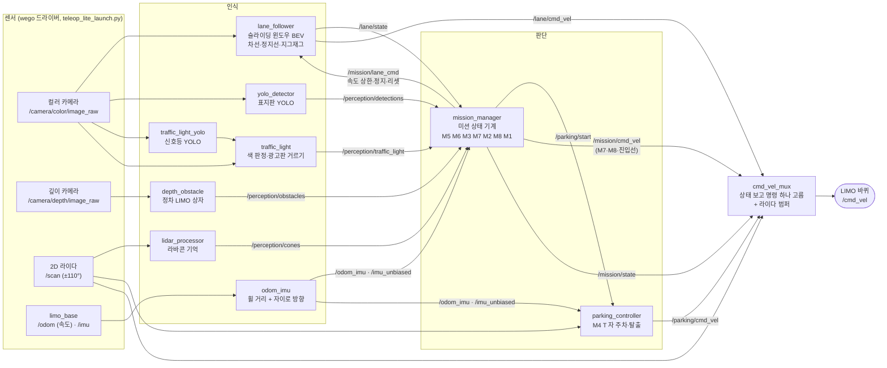

# AutoRace 2026 — LIMO Pro 자율주행 (대회용 `final`)

2026 국민대 AutoRace 에 **AgileX LIMO Pro (아커만 조향, Jetson Orin)** 로 출전하기 위한 ROS 2 Humble 자율주행 스택이다.
카메라 차선 추종을 기본으로 달리면서, 표지판·장애물·라바콘·신호등을 보고 8 개 미션을 순서대로 수행한다.

- 기준 코드: 태그 `real-best-1112` (11-12 실차 ack56 — 출발선부터 주차·탈출까지 사람 손 없이 완주)
- 이 브랜치에는 **대회 때 쓰는 코드와 사용법만** 있다. 실차 주행 기록·분석·시뮬 도구는 `ackermann` 브랜치에 있다.
- 대회장에서 할 일은 [`대회장_체크리스트.md`](대회장_체크리스트.md), 리모 실행 스크립트는 [`tools/limo/`](tools/limo/README.md).

---

## 1. 전체 파이프라인



**운전의 주인은 늘 하나다.** 평소에는 `lane_follower` 가 차선을 따라 운전하고 `mission_manager` 는 속도 상한·정지만 지시한다.
정적 장애물 (M7)·진입선 따라가기·라바콘 (M8) 동안은 `mission_manager` 가, 주차 (M4) 동안은 `parking_controller` 가 직접 운전한다.
`cmd_vel_mux` 가 `/mission/state`·`/parking/state` 를 보고 셋 중 하나만 바퀴로 보낸다.

---

## 2. 노드

| 노드 (패키지) | 하는 일 | 주요 출력 |
|---|---|---|
| `lane_follower` (autorace_lane) | 영상을 위에서 본 그림 (BEV) 으로 펴고 슬라이딩 윈도우로 두 노란 선을 찾아 PID 조향. 정지선 (흰 가로선) 거리, 선 맞춤 잔차 (지그재그) 도 잰다 | `/lane/cmd_vel`, `/lane/state`, `/lane/debug` |
| `yolo_detector` (autorace_perception) | YOLOv8 표지판: crosswalk·parking·slow·speed_bump·turn_a·turn_b. 최신 영상 한 장만 처리 (밀린 영상 안 쌓음) | `/perception/detections` |
| `traffic_light_yolo` + `traffic_light` | 신호등 몸체를 YOLO 로 찾고, 그 안 밝은 칸 색과 YOLO 색이 같을 때만 채택. 박스 크기를 정지선 거리로 확인해 광고판 모니터 속 가짜 신호등을 버림 | `/perception/traffic_light` |
| `depth_obstacle` | 깊이 점을 바닥 기준 좌표로 바꿔 높이 범위 안 점을 묶어 상자로 (정차 LIMO). 방지턱·노면 표시는 높이로 거름 | `/perception/obstacles` |
| `lidar_processor` | 라이다 점을 묶어 지름이 라바콘 크기인 것만 odom 좌표로 기억 | `/perception/cones` |
| `odom_imu` (autorace_mission) | 휠은 거리만, 방향은 자이로 적분. 멈출 때마다 자이로 치우침을 다시 잼 (ZUPT) | `/odom_imu`, `/imu_unbiased` |
| `mission_manager` | 미션 상태 기계. M7·M8·진입선은 직접 운전 | `/mission/state`, `/mission/lane_cmd`, `/mission/cmd_vel` |
| `parking_controller` | M4 빈칸 찾기·T 자 주차·탈출 | `/parking/cmd_vel`, `/parking/state` |
| `cmd_vel_mux` | 명령 고르기, 입력 끊기면 0, 라이다 범퍼 (앞 0.10 m·뒤 0.08 m) | `/cmd_vel` |

---

## 3. 미션별 알고리즘

트랙 순서: 출발 → **M5** 서행 (방지턱) → **M6** 서행 유도선 → **M3** 보행자 정지 → 코너 → **M7** 정적 장애물 (3 차로) → **M2** 갈림길 → **M8** 라바콘 → **M1** 신호등 → **M4** 주차.
원칙은 "보이면 켜지고, 조건으로 끝난다" 이다. 가벼운 순서 힌트 (예: 갈림길을 지나면 M5·M6·M3·M7 은 안 켬) 로 오인식을 막는다.

### M5 서행 구간 (방지턱)
- YOLO `slow`·`speed_bump` 가 최근 5 장 중 3 장 → 앞 흰 가로선을 기억해 두고, 차 앞이 그 선에 닿으면 0.15 m/s (기본 0.30 의 절반).
- 표지판을 마지막으로 본 곳에서 1.5 m 지나면 원래 속도.

### M6 서행 유도선 (지그재그)
- 톱니 모양 선은 직선으로 맞추면 잔차가 커진다. 선 맞춤 잔차 ≥ 7.5 px 가 5 장 연속이면 0.15 m/s (규정 v3: 0.2 m/s 이하 의무), 잔차가 내려간 뒤 0.3 m 에 해제.

### M3 보행자 표지판 정지
- YOLO `crosswalk` → 0.15 m/s 로 접근하며 BEV (차 앞 0.37~0.75 m) 에서 흰 가로선을 찾는다. 줄무늬 막대 (덮는 비율 ~0.6) 와 정지선 (0.85~0.99) 을 덮는 비율 0.82 로 가른다.
- 처음 잡은 선 위치를 odom 좌표로 기억하고, 화면 밖으로 사라진 뒤는 오도메트리로 남은 거리를 이어서 잰다. 남은 거리에 비례해 감속, 바퀴 맨 앞이 선 2.5 cm 앞에 오면 정지.
- 완전 정지 후 4 초 → 발진. 실차 8 번 연속 정지선 −2~0 cm.

### 진입선 따라가기 (M3 → M7 코너, 11-12 추가)
실차는 M3 뒤 우회전 코너를 거의 매번 20~28° 덜 돈 채 3 차로 입구에 닿았고, 입구 바로 뒤 45° 로 벌어지는 깔때기 선을 차선 추종이 따라가 옆 차로로 흘러 들어갔다.
그런데 차는 **M3 정지선에서 정확히 섰고, 거기서 몇 도 돌았는지 안다** (주차와 같은 원리).

- 트랙 도면상 가운데 차로 중심선 = M3 정지 자세에서 앞으로 1.70 m, 방향 = M3 방향 − 90°.
- 코너가 35° 남으면 미션이 조향을 넘겨받아 그 선을 따라간다:
  곡률 = 3.0 × 방향 오차 − 3.0 × 옆 오차 (+ 덜 돌았으면 코너 곡률 1/0.95), 최소 반경 0.6 m, 0.2 m/s.
- 깔때기에서는 차선 추종을 무시하고 직선을 유지 → 장애물이 보이면 그대로 M7 로. 장애물이 없으면 M3 에서 2 m 뒤 차선 추종으로.
- 안전장치: 출발 직선에서 잰 트랙 축의 90° 방향과 목표가 6° 넘게 다르면 켜지 않음.
- 효과: M7 시작 방향 오차 20~28° → **3~6°**.

### M7 정적 장애물 (3 차로, 정차 LIMO 7 대)
1. **켜짐**: 내 차로 앞 1.2 m 안 상자 3 장 연속.
2. **차로 격자**: 0.52 m 간격 3 차로. 차로 방향 = 트랙 축의 90° 단위. 지금 차로는 M3 정지 자세에서 온 거리로 계산 (깔때기에서 흘러도 맞게), 맨 바깥 차로에선 노란 선으로 보정.
3. **장애물 기억**: 깊이 상자를 odom 좌표로 기억해 카메라 화면 밖 (옆) 에 있어도 피한다. 라이다 빔이 상자를 지나가면 오검출로 지움.
4. **차로 고르기**: 내 차로 앞이 막히면, 그 장애물을 지난 뒤 비어 있는 옆 차로로. 갈림길 표지판을 봤으면 그쪽 차로를 먼저.
5. **경로 (아커만)**: 원호 두 개 (현재·다음 곡률) 121 조합을 미리 계산한 자세표로 한 번에 쓸기 검사 (차 사각형 vs 상자, SAT) → 목표 차로로 가는 가장 좋은 원호. 처리 20~80 ms (실차).
6. **막혔을 때**: 2 s 동안 갈 원호가 없으면 후진 0.2 m (같은 자리 3 번째부터 0.3 m). 후진 방향은 시작할 때 한 번 정하고, 노란 선은 바퀴 규칙으로 막는다.
7. **끝**: 내 차로 앞 1 m 가 비고 변경이 끝나면 차선 추종으로. 갈림길 쪽 끝 차로가 아니면 먼저 옮긴 뒤 끝낸다.

### M2 갈림길 (A 왼쪽 / B 오른쪽)
- YOLO `turn_a`·`turn_b` 3 장 연속이면 결과 기억, 표지판 박스가 45 px 이상이면 잠금. 표지판이 바뀌면 마지막 것을 따름.
- 장애물을 다 지났는데 표지판을 못 봤으면 가운데 차로로 옮겨 천천히 가며 기다림.
- 그래도 3 장 연속을 못 채웠으면 **M7 동안 본 turn_a / turn_b 장 수가 많은 쪽** (약한 근거) 으로.

### M8 라바콘
- 라이다 라바콘 기억에서 통로를 가로지르는 두 콘의 틈 (Follow-the-Gap) 가운데를 이어 따라감. 좁으면 0.1 m/s.
- 마지막 틈을 지나면 바로 **코너 보조** (최대 오른쪽). 끝 방향 = 트랙 축 +90° (신호등 직선) — 라바콘이 코너 안까지 놓여 이미 다 돌았으면 바로 차선 추종.

### M1 신호등 (광고판 모니터 방해)
- 색이 확인되면 정지선 쪽으로 (M3 와 같은 정지선 코드). 크기까지 확인한 초록이 이어지면 서지 않고 통과.
- 통과 중 노랑·빨강 → 다시 정지선에 섬. 정지 중 초록 8 번 연속 → 발진.

### M4 T 자 주차·탈출
- M1 을 지나 주차 표지판을 보면 `parking_controller` 가 넘겨받음.
- 옆 라이다로 정차 LIMO 사이 빈칸 길이를 재고 (짧은 물체 한 번은 무시하고 이어 잼), 칸 가운데 − (최소 반경 + 0.08 m) 에서 원호로 들어가 정렬 → 정지 → 같은 길로 빠져나와 처음 방향.

---

## 4. 리모에 설치

리모 쪽 폴더는 `~/AutoRace2026_sim2d/` (워크스페이스 `~/AutoRace2026_sim2d/autorace_ws`).

```bash
# PC 에서
git clone -b final https://github.com/mark2455/AutoRace2026.git && cd AutoRace2026
rsync -a autorace_ws/src/ wego@<리모IP>:AutoRace2026_sim2d/autorace_ws/src/
rsync -a tools/limo/ wego@<리모IP>:AutoRace2026_sim2d/        # 실행 스크립트·센서 launch·신호등 모델

# 리모에서
cd ~/AutoRace2026_sim2d/autorace_ws
source /opt/ros/humble/setup.bash && colcon build
```

필요: wego 기본 워크스페이스 `~/wego_ws` (limo_base·카메라·라이다 드라이버), `miniconda3` 의 `dl_env` (ultralytics), CUDA 12.6.
LIMO 드라이버 조향 배율 `left/right_angle_scale_` 이 **1.0** 이어야 한다 (2.47 이면 바퀴가 절반만 꺾임 — 체크리스트 참고).

---

## 5. 주행 명령어

```bash
# 1) 센서 (EKF·점구름·IR 끔). /limo_status 의 control_mode 가 1 인지 확인 (리모컨 쓰면 3 → 명령 무시)
source /opt/ros/humble/setup.bash && source ~/wego_ws/install/setup.bash
ros2 launch ~/AutoRace2026_sim2d/teleop_lite_launch.py
ros2 topic echo /limo_status --once | grep -E "control_mode|battery"

# 2) 주행 (대회: NOBAG=1 로 녹화 끔 — 녹화가 카메라 압축으로 CPU 를 크게 씀)
cd ~/AutoRace2026_sim2d
NOBAG=1 LIGHT=yolo MP=full.yaml setsid nohup bash run_drive.sh race1 \
  light_model:=$HOME/AutoRace2026_sim2d/sign_best2_1110.pt \
  light_params:=$HOME/AutoRace2026_sim2d/light_best.yaml > /tmp/race1.out 2>&1 < /dev/null &
# 로그: ~/AutoRace2026_sim2d/runs/<월일_시분초>_race1/drive.log

# 3) 멈춤 — "주행 노드 모두 꺼짐" 이 나올 때까지 다시
bash ~/AutoRace2026_sim2d/stop_drive.sh
```

| 하고 싶은 것 | 방법 |
|---|---|
| 바퀴는 안 돌리고 인식·판단만 | `run_drive.sh 이름 enable:=false` |
| 속도 바꾸기 | 앞에 `SPEED=0.35` (기본 0.3, 규정 권고 0.3~0.4) |
| 녹화하며 연습 | `NOBAG=1` 을 뺌 (bag 이 주행 폴더 `bag/` 에) |
| CPU 기록 | `bash cpu_log.sh <주행 폴더>/cpu` 를 같이 켬 |
| 지금 BEV 보기 | `python3 bevsnap.py <폴더>` (lane_follower 가 떠 있을 때 `/lane/debug` 한 장) |

### 로그에서 볼 것

```bash
D=$(ls -td ~/AutoRace2026_sim2d/runs/*/ | head -1)
grep -a "\[상태\]" $D/drive.log            # 미션 전환과 그 이유
grep -a "M7 진입\|\[M7\] 아커만" $D/drive.log  # 진입 방향 오차
grep -a "\[M2\]" $D/drive.log              # 갈림길 결정
grep -a "lane_follower\]: .* fps" $D/drive.log | tail   # 차선 인식 fps (10 이상 정상)
```

---

## 6. 설정

실차 값은 모두 `autorace_ws/src/autorace_bringup/config/real_limo.yaml` 한 파일에 있고, 패키지 기본값 위에 덮어쓴다.
새 기능은 코드 기본값을 끄고 이 파일에서만 켠다.

| 묶음 | 키 | 값 (11-12) |
|---|---|---|
| 카메라 보정 (차선) | `camera_height`·`camera_pitch_deg`·`camera_yaw_deg` | 0.182 m · 6.31° · −0.64° |
| 카메라 보정 (깊이) | `cam_height`·`cam_pitch_deg` (depth_obstacle, lidar_processor `tall_cam_*`) | 0.185 m · 3.25° |
| 노란 선 색 | `yellow_hsv_lo/hi` | [10,57,119] ~ [27,255,255] |
| 정지선 | `stop_line_min_cov` | 0.82 |
| 진입선 따라가기 | `m7_entry_guide`, `m7_entry_from_m3` | 켬 |
| M7 처리 속도 | `m7_ack_fast`, `sensor_thread`, `small_queues` | 켬 |
| M7 후진 회복 | `m7_ack_back_fix`, `m7_ack_back_limit_off`, `m7_back_far_after 3` | 켬 |
| M7 갈림길 끝 | `m7_final_direct`, `m7_final_lock_ok`, `m7_final_clear_ends`, `m7_wait_sign`, `m2_weak_fallback` | 켬 |
| M8 코너 | `m8_ack_exit_turn_now`, `m8_ack_assist_target_deg 90` | 켬 |
| 주차 | `gap_blip_ok` | 켬 |

카메라를 건드렸거나 대회장 조명이 다르면 다시 보정한다 (직선 차로 가운데에 똑바로 세우고):

```bash
source ~/AutoRace2026_sim2d/env.sh
ros2 run autorace_lane lane_calib --topic /camera/color/image_raw --hfov 66.4 --out ~/calib
ros2 run autorace_perception depth_calib --lane_h <lane_calib 높이> --lane_pitch <lane_calib 각도> --out ~/dcal
# "✓ 도면 폭과 맞음" 이 나오면 출력값을 real_limo.yaml 에 넣고 colcon build --packages-select autorace_bringup
```

---

## 7. 규정 메모 (규정집 v3, 11-12)

- 모든 팀 아커만. 기본 속도 0.3~0.4 m/s 권고, 서행 구간 0.2 m/s 이하 (M5·M6).
- M7·M6·M8 은 체크포인트마다 균등 배점 (10/6/3, 15/10/5) — 끝까지 못 가도 앞 구간 점수.
- **판정 기준점이 '뒷바퀴'** 로 바뀜. 지금 코드는 바퀴 맨 앞을 정지선 2.5 cm 앞에 세운다 — 정지선 ±5 cm 를 뒷바퀴로 재는지 운영 측 확인 필요 (그렇다면 정지 위치를 축간 거리만큼 옮겨야 함).

---

## 8. 폴더

```
autorace_ws/src/
  autorace_bringup/     real_limo.yaml (실차 설정), launch
  autorace_lane/        lane_follower, sliding_window, lane_calib
  autorace_perception/  yolo_detector, traffic_light, depth_obstacle, lidar_processor, depth_calib, 표지판 모델
  autorace_mission/     mission_manager, avoid (쓸기 검사), parking_controller, cmd_vel_mux, odom_imu, drive.launch.py
  autorace_msgs/        LaneState, LaneCmd, DetectionArray, ObstacleArray, TrafficLight
  autorace_sim/ autorace_track/   2D 시뮬·트랙 도면 (패키지 의존성 때문에 같이 빌드)
tools/limo/             리모 실행 스크립트·센서 launch·신호등 모델 (리모 ~/AutoRace2026_sim2d/ 에 둠)
대회장_체크리스트.md       대회장 보정·확인 순서
```
